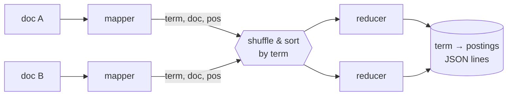

# Positional Inverted Index with MapReduce

A **positional inverted index** for the 20 Newsgroups corpus, built with a
Hadoop-streaming **MapReduce** job. A small query engine on top supports
**Boolean** (`AND` / `OR` / `NOT`, nested with parentheses) and **phrase**
queries.

```bash
$ python index.py 20_newsgroups
Indexed 22 documents, 3736 terms -> index.tsv

$ python query.py index.tsv '"space station"' '(nasa OR orbit) AND NOT moon'
1 docs: ['sci.space/59874']
2 docs: ['sci.space/59904', 'sci.space/59913']
```

## What's a positional index?

A plain inverted index maps `term → [doc ids]`. A positional index also stores
**where** each term appears in each document:

```
shuttle  →  {"sci.space/59873": [12, 87], "sci.space/59904": [3]}
space    →  {"sci.space/59873": [11, 40], "comp.graphics/37913": [5]}
```

With positions you can answer **phrase queries**: `"space shuttle"` matches
only documents where `space` is at position *p* and `shuttle` at *p + 1*. A
plain index can only say that both words appear somewhere in the document.

## MapReduce design



| Phase | What it does | File |
|---|---|---|
| **Map** | Normalize each document: lowercase, alphabetic tokens, stopword removal, WordNet lemmatization. Emit `term \t doc_id \t position`. | [`mapper.py`](mapper.py) |
| **Shuffle/sort** | Hadoop groups all records for the same term and sends them to one reducer, in sorted order. | (framework) |
| **Reduce** | Stream through the sorted records with `groupby`, collect `doc → sorted positions`, emit one JSON line per term. Only **one term's postings are in memory at a time**. | [`reducer.py`](reducer.py) |

[`index.py`](index.py) runs **the same mapper and reducer functions**
locally (map → sort → reduce), so you don't need a Hadoop cluster to try it.
A test checks that piping through the real streaming scripts
(`mapper.py | sort | reducer.py`) gives output identical to the local build.

### Running on Hadoop

```bash
hadoop jar $HADOOP_HOME/share/hadoop/tools/lib/hadoop-streaming-*.jar \
  -files mapper.py,reducer.py,text.py \
  -input  /data/20_newsgroups/*/* \
  -output /out/positional_index \
  -mapper mapper.py -reducer reducer.py
```

The mapper reads the current file name from `mapreduce_map_input_file`
(Hadoop 2+) or `map_input_file` (Hadoop 1) to get the document id.

## Query engine

[`query.py`](query.py) is a recursive-descent parser over this grammar:

```
expr   := and ("OR" and)*
and    := unary (["AND"] unary)*      # adjacent terms are implicitly ANDed
unary  := "NOT" unary | "(" expr ")" | "quoted phrase" | word
```

Precedence is `NOT` > `AND` > `OR`, as in most search engines. Queries go
through **the same normalization as the index**, so `Shuttles` finds
`shuttle`.

| Operation | Algorithm | Cost |
|---|---|---|
| `f_and(a, b)` | Two-pointer merge of sorted postings | O(\|a\| + \|b\|) |
| `f_or(a, b)` | Sorted union | O((\|a\| + \|b\|) log) |
| `NOT a` | Complement against all doc ids | O(N) |
| `"t1 t2 … tk"` | AND the doc lists, then intersect shifted position sets `{p − i}` for each term *i* | O(Σ postings) |

## Quickstart

```bash
git clone git@github.com:hsoni0303/Positional_Inverted_Index_With_Map_Reduce.git
cd Positional_Inverted_Index_With_Map_Reduce
pip install -r requirements.txt      # NLTK; stopwords and WordNet download on first run

python index.py 20_newsgroups         # build index.tsv
python query.py index.tsv             # interactive: query> "space shuttle" AND nasa
pytest -q
```

The repo includes a 22-document sample from 10 newsgroups. For the full
corpus (~20k documents), download
[20news-19997.tar.gz](http://qwone.com/~jason/20Newsgroups/20news-19997.tar.gz)
and point `index.py` (or Hadoop) at it.

## Project structure

```
├── text.py      # shared normalization (index and queries must match)
├── mapper.py    # Hadoop-streaming mapper
├── reducer.py   # Hadoop-streaming reducer (streaming groupby, JSON output)
├── index.py     # local map → sort → reduce runner + loader
├── query.py     # Boolean/phrase query parser and postings algebra
└── tests/       # positions, operators, phrase adjacency, parser, Hadoop parity
```

## Changelog

**v2** fixes a reducer bug where the postings string was never reset
between documents, so one document's positions leaked into the next. It
replaces the Python-dict-repr output (which was parsed back by string
slicing) with JSON, adds phrase queries and a nested Boolean parser, and adds
tests.
